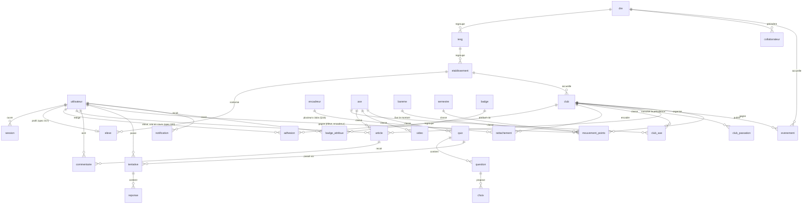
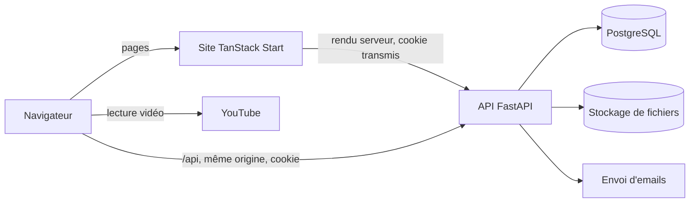

# ARCHITECTURE

## Stack technique

Versions installées et vérifiées dans le dépôt le 2026-11-02 (`package.json`, `backend/uv.lock`).

| Couche            | Choix                                                                    |
| ----------------- | ------------------------------------------------------------------------ |
| Site              | TanStack Start, React 19, Vite 8, Tailwind 4, shadcn/Radix, TypeScript   |
| Données côté site | TanStack Query, React Hook Form, Zod                                     |
| API               | FastAPI 0.162, Python 3.14, Pydantic, SQLAlchemy 2.1 asynchrone, asyncpg |
| Migrations        | Alembic 1.20                                                             |
| Base de données   | PostgreSQL 18                                                            |
| Paquets           | Bun et `bun.lock` pour le site, uv et `uv.lock` pour l'API               |
| Tests             | Vitest, pytest ; Playwright via MCP pour les parcours                    |
| Qualité           | ESLint et Prettier, Ruff                                                 |

## Modèles de données

Noms métier en français, sans accent (voir AGENTS.md). Identifiants en UUID, dates en UTC.

Champs structurants :

- `utilisateur` : `role` (eleve, encadreur, admin), `identifiant` unique, `email` unique facultatif
  pour l'élève et obligatoire pour les autres, `telephone`, `prenom`, `nom`, `mot_de_passe_hash`,
  `statut`, `consentement_le`.
- `dre`, `iesg`, `etablissement` (spec 016) : le découpage scolaire. Une DRE a un `code` stable (clé
  primaire, aussi utilisée par `collaborateur.perimetre_dre`) ; IESG et établissements ont un UUID.
  La DRE d'un établissement se déduit de son IESG. Chaque table a un `nom_normalise` (sans accents ni
  majuscules) qui porte l'unicité dans le parent, un statut actif ou inactif (`propose` en plus pour un
  établissement) et une `version` pour le verrou optimiste. Rien ne se supprime.
- `axe` (spec 016) : les 7 axes d'intervention (Q1), avec un `code` stable, un `libelle`, une
  `description` courte et un `ordre`.
- `club` (spec 019) : demande de création puis club officiel d'un établissement. `etablissement_id`,
  `nom` (officiel, unique après normalisation dans l'établissement), `nom_normalise`, `description`
  courte (facultative, bornée), `demandeur_id`, `president_id` (le gestionnaire courant, nul tant que
  la demande est en attente), `encadreurs_associes` (JSON borné, à titre déclaratif pour la vérification,
  aucun compte ni rattachement), `etat` (en_attente, actif, refuse), `motif_refus` (obligatoire en
  cas de refus, CHECK), `demande_le`, `decide_le`, `decide_par`, `actif_le`, `version` (verrou
  optimiste). Un seul club actif par établissement (index partiel unique). Voir aussi `club_axe`.
- `club_axe` (spec 019) : jusqu'à 3 axes privilégiés par club, jointure `club_id` + code de l'axe.
- `club_passation` (spec 019, Q19 en spec 020) : proposition de transmission de la présidence par le
  président sortant vers un **membre** du club (`successeur_id`, `propose_par`, `propose_le`, `etat`
  en_attente_encadreur / en_attente / validee / refusee, `confirmee_par`, `confirmee_le`, `motif_refus`,
  `decide_le`, `decide_par`, `version`). Si le club a un encadreur rattaché, celui-ci confirme d'abord
  (`en_attente_encadreur`) ; sans encadreur, la passation va directement à l'admin. Une seule passation en
  attente par club (index partiel unique sur les deux états d'attente). La décision change le gestionnaire
  du club, jamais le rôle des comptes.
- `adhesion` (spec 020) : l'affiliation d'un élève. `eleve_id`, `club_id`, `etat`
  (en_attente_president, en_attente_validation, active, refusee, retiree), `confirme_*` (le président),
  `decide_*` (le collaborateur, ou le président pour un refus), `motif_refus` (obligatoire au refus),
  `retire_*`, `motif_retrait`, `version`. Une seule adhésion en cours par élève, tous clubs confondus
  (index unique partiel) ; une nouvelle demande crée une nouvelle ligne, l'historique reste. Le président
  est membre de droit de son club.
- `rattachement` (spec 020) : le lien d'un encadreur à un club, mêmes états au masculin (`actif`, `refuse`,
  `retire`). `supplementaire` : l'encadreur avait déjà un club actif ; recalculé sous verrou à la décision,
  seule l'équipe nationale le valide (Q16). Une seule demande en cours par encadreur et par club.
- `article` : `type` (activite, magazine, parole_eleve), `titre`, `contenu` en texte simple, `axe_id`,
  `club_id` facultatif, `auteur_id`, `photo`, `statut` (brouillon, soumis, publie, rejete),
  `motif_rejet`, `modere_par`, `publie_le`.
- `evenement` : `titre`, `type` (sensibilisation, nettoyage, depistage, defi), `debut`, `fin`, `lieu`,
  `dre_code`, `club_id` facultatif.
- `video` : `titre`, `youtube_id`, `axe_id`. `document` : `titre`, `type` (magazine, guide, fiche),
  `fichier`, `couverture`, `publie_le`.
- `tentative` : `quiz_id`, `eleve_id`, `commencee_le`, `terminee_le`, `score`, `reussie`.
  `reponse` : `question_id`, `choix_id`, `envoyee_le`, `repondue_le`.
- `eleve` (spec 017) : le profil d'un compte élève, lié un à un à `utilisateur`. `pseudonyme` (seule
  identité publique, Q20) et `pseudonyme_normalise` unique (sans accents, majuscules, espaces ni
  ponctuation), `classe`, `etablissement_id`, `charte_version`. Le prénom et le nom restent dans
  `utilisateur` et ne sortent pas de l'espace admin.
- `encadreur` (spec 018) : le profil d'un compte encadreur, lié un à un à `utilisateur`. `etablissement_id`,
  `fonction` (et `fonction_precision` pour « autre »), `etat` de la vérification (en_attente, actif, refuse),
  `demande_le`, `decide_le`, `decide_par`, `motif_refus`, `charte_version`. L'état est distinct de
  `utilisateur.statut` (la suspension, qui prime). Seul un encadreur actif passera la dépendance
  `encadreur_actif`, que les clubs et les rattachements (R4, R5) utiliseront.
- `mouvement_points` (spec 017, ADR-0004) : `utilisateur_id` (R4 ajoutera `club_id`), `action` (code du
  barème), `montant` copié du barème au moment du gain, `semestre_id` (nul hors semestre), `cle` unique
  d'idempotence, `valide_par`, `annule_id` (une annulation est une ligne négative), `cree_le`. Jamais
  modifié ni supprimé. Seule la fonction `points.service.crediter` y écrit.
- `bareme` (spec 017) : une ligne par action et par bénéficiaire (`eleve.bienvenue`, `club.quiz_eleve`…),
  `montant` réglable, `propose` (montant à valider, Q22), `en_service` (une spec livrée l'écrit déjà),
  `actif`. Préremplie avec la grille du PRD.
- `semestre` (spec 017) : `libelle`, `debut`, `fin` (dates de Lomé, UTC+0). Une contrainte d'exclusion
  interdit deux semestres qui se chevauchent ; un semestre commencé ne se modifie plus, sauf pour
  prolonger un semestre en cours.

Le référentiel (`dre`, `iesg`, `etablissement`, `axe`) est chargé par la migration `referentiel` depuis
`backend/alembic/donnees/annuaire.json`, puis géré depuis `/admin/referentiel`. Le site lit ses listes
dans l'API (`/api/referentiel/…`) ; `src/lib/togo-dre.ts` ne garde que le dessin de la carte.

## Architecture générale

- **Site** : rendu serveur pour les pages publiques (référencement, affichage rapide sur réseau lent).
  Il n'a aucune logique métier et n'accède jamais à la base (ADR-0002).
- **API** : seule détentrice des données et des règles. Chaque domaine vit dans son dossier sous
  `backend/app/` (`comptes/`, `admin/`, `referentiel/`, `eleves/`, `encadreurs/`, `points/`, `clubs/`, `articles/`, `agenda/`, `mediatheque/`, `quiz/`),
  avec `router.py` (HTTP), `schemas.py` (Pydantic), `models.py` (SQLAlchemy) et `service.py` (règles).
- **Types partagés** : `backend/openapi.json` est versionné, et `npm run api:types` en génère les types
  TypeScript avec `openapi-typescript`. La CI vérifie que les deux restent à jour.

## Authentification et autorisations

Sessions en base et cookie sécurisé (ADR-0003). Les droits sont contrôlés dans l'API, sur chaque route,
pour la ressource demandée.

| Action                                                                    | Visiteur | Élève                     | Encadreur                 | Admin                                         |
| ------------------------------------------------------------------------- | -------- | ------------------------- | ------------------------- | --------------------------------------------- |
| Lire les contenus publiés                                                 | Oui      | Oui                       | Oui                       | Oui                                           |
| Passer un quiz avec points                                                | Non      | Oui                       | Non                       | Non                                           |
| Voir son Passeport                                                        | Non      | Le sien                   | Non                       | Oui                                           |
| Soumettre un témoignage                                                   | Non      | Oui                       | Non                       | Non                                           |
| Soumettre une activité, ajouter à l'agenda                                | Non      | Non                       | Pour son club             | Oui                                           |
| Voir la console d'un club                                                 | Non      | Non                       | Son club                  | Oui                                           |
| Retirer un élève, réinitialiser son accès                                 | Non      | Non                       | Élèves de son club        | Oui                                           |
| Commenter                                                                 | Non      | Non                       | Oui                       | Oui                                           |
| Demander à rejoindre un club (spec 020)                                   | Non      | Club de son établissement | N'importe quel club actif | Non                                           |
| Confirmer ou refuser une demande, retirer un membre (spec 020)            | Non      | Président de ce club      | Non                       | Non                                           |
| Voir la liste des membres d'un club (spec 020)                            | Non      | Membre ou président       | Clubs où il est rattaché  | Sa DRE                                        |
| Valider une affiliation ou un rattachement (spec 020)                     | Non      | Non                       | Non                       | Sa DRE (national pour un club supplémentaire) |
| Confirmer le nouveau président d'un club (Q19, spec 020)                  | Non      | Non                       | Clubs où il est rattaché  | Non                                           |
| Modérer, publier vidéos et documents, valider un club, attribuer un badge | Non      | Non                       | Non                       | Oui                                           |

Un élève ne peut ni voir les coordonnées d'un autre utilisateur, ni être contacté par un autre
utilisateur. Sur les pages publiques, un élève apparaît par son pseudonyme et le nom de son club.

## Intégrations externes

| Service        | Usage                                   | Clé    | Coût et limite                               | État                             |
| -------------- | --------------------------------------- | ------ | -------------------------------------------- | -------------------------------- |
| YouTube        | Lecture des capsules (mode sans cookie) | Aucune | Gratuit ; dépend de la chaîne SOS DOCTEUR TV | Q11                              |
| Envoi d'emails | Invitations d'encadreurs, mots de passe | Oui    | Quota gratuit à vérifier                     | Fournisseur à choisir (spec 003) |
| Stockage S3    | Photos et PDF (ADR-0005)                | Oui    | Au volume                                    | Fournisseur à choisir (Q10)      |

## Environnements et déploiement

- **Local** : `docker-compose.yml` pour PostgreSQL, site sur le port 3000, API sur le port 8000 ;
  commandes dans `AGENTS.md`.
- **Préproduction et production** : un seul VPS, un projet Docker Compose et une base par environnement, derrière un
  même proxy Caddy qui sert le site et oriente `/api` vers l'API (ADR-0006, ADR-0007). `develop` déploie la preprod,
  `main` la prod. Procédure complète : `deploy/README.md`.
- **Migrations** : `alembic upgrade head` au déploiement, après une sauvegarde, avant le démarrage de la nouvelle API.
- **Retour arrière** : automatique si les nouveaux conteneurs ne démarrent pas, ou par le workflow lancé à la main
  avec un SHA. Les migrations doivent rester compatibles avec la version précédente.
- **Sauvegardes** : `pg_dump` quotidien, gardé 14 jours sur le VPS. La copie chiffrée hors du serveur reste à mettre en
  place avant l'ouverture.
- **Secrets** : un fichier par environnement sur le VPS, en droits `600`, jamais dans le dépôt. GitHub ne connaît que
  l'accès SSH.

## Observabilité

- Logs structurés de l'API, sans mot de passe ni donnée personnelle d'élève.
- `GET /health` vérifie la base ; un service externe de surveillance l'interroge en production.
- Suivi d'erreurs : à choisir dans la spec 002, sans envoyer de données d'élèves à un tiers.
- `src/lib/error-capture.ts` et `src/lib/error-page.ts` gèrent déjà les erreurs de rendu du site.

## Choix techniques

- [ADR-0001](decisions/0001-backend-fastapi-postgresql.md) — FastAPI, SQLAlchemy asynchrone, Alembic, uv, PostgreSQL 18
- [ADR-0002](decisions/0002-site-rendu-serveur-et-api-unique.md) — Le site reste en TanStack Start, l'API détient seule les données et les règles
- [ADR-0003](decisions/0003-sessions-en-base-et-identifiant-eleve.md) — Sessions en base, cookie sécurisé, élève sans email obligatoire (proposé)
- [ADR-0004](decisions/0004-journal-de-points-et-quiz-cote-serveur.md) — Journal de points immuable, quiz arbitré par le serveur (proposé)
- [ADR-0005](decisions/0005-videos-youtube-et-fichiers-s3.md) — Vidéos sur YouTube, photos et PDF en stockage S3 (proposé)
- [ADR-0006](decisions/0006-site-et-api-sur-la-meme-origine.md) — Site et API sur la même origine, API sous `/api`
- [ADR-0007](decisions/0007-deploiement-vps-docker-compose.md) — VPS unique, Docker Compose, Caddy et images GHCR

## Points d'attention

Issus du stress-test du 2026-11-02. Les risques bloquants sont traités dans le PRD ou les ADR ; ceux-ci
restent à surveiller.

**Bloquants avant l'ouverture**

- **Données de mineurs** : aucune donnée réelle avant le récépissé de l'IPDCP et l'avis d'un juriste
  sur le consentement (Q8, Q9). L'analyse de la loi ici n'est pas un avis juridique.
- **Contenus de santé** : pas de quiz publié sans validation médicale nommée (Q11). Sans contenus, les
  specs 009 à 011 seront techniquement prêtes, mais inutilisables.
- **Écarts Q1 et Q2** : ils touchent tout le classement et le classement des contenus. À trancher avant
  les specs 003 et 006, même si les tables de référence limitent le coût d'un changement.

**Importants**

- **Triche aux quiz** : un chrono serveur empêche de dépasser le temps, pas de se faire aider, ni de
  relever les réponses à force de reprises. Acceptable pour des points, insuffisant pour des lots en
  argent : d'où le concours hors MVP.
- **Gonflement des scores** : faux élèves (+50) et commentaires vides (+10) restent possibles dans les
  limites prévues. Tout est tracé dans le journal et annulable. Les classements publics gardent donc le
  risque d'une contestation par un club.
- **Règle des 3 encadreurs** : elle vaut à l'enregistrement. Après une mutation, le club passe sous 3
  encadreurs : il reste actif, l'admin le voit, et un remplaçant est invité. Un dernier encadreur qui part
  laisse un club sans gestionnaire : l'admin le suspend.
- **Modération** : tout passe par une petite équipe. Avec 844 clubs, le volume peut dépasser sa capacité :
  à suivre avec le critère des 48 heures.
- **Photos d'élèves** : le retrait de consentement doit dépublier l'article. Les métadonnées, dont la
  position GPS, sont retirées à l'envoi.
- **Quiz sur réseau lent** : une tolérance de 2 secondes peut rester insuffisante en 2G. Une coupure
  compte la question comme ratée, l'élève peut reprendre le quiz.
- **Pic de charge** : une classe entière, ou un concours, peut se connecter à la même heure ; le hachage
  Argon2 consomme de la mémoire à chaque connexion. À tester avant l'ouverture sur le serveur retenu.
- **Mises à jour Python** : Python 3.14 est récent, chaque dépendance doit fournir des paquets compatibles.

**Mineurs**

- Égalités au classement : le premier à atteindre le score passe devant.
- Heure : le Togo est en UTC toute l'année, les dates sont stockées en UTC et affichées sans ambiguïté.
- Fin d'année scolaire : pas de remise à zéro ni de saisons dans le MVP.
- Élève qui quitte son club : ses points restent les siens, ceux déjà acquis par le club restent au club.

**Sur-conception écartée** : file de tâches, cache, WebSocket, microservices et Redis ne sont pas prévus.
Un seul PostgreSQL suffit à plusieurs dizaines de milliers de comptes.
